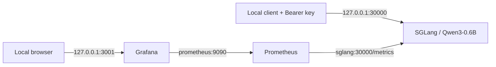

# SGLang Serving Lab

A single-GPU Qwen3-0.6B serving lab with Docker Compose, API-key authentication,
Prometheus, provisioned Grafana dashboards, and synthetic benchmark evidence.
The deployment configuration is version controlled; this is a local lab, not an
internet-facing production service.



## Learning roadmap

See [学习计划与当前进度](docs/learning-plan.md) for the project learning goals,
completed milestones, next step, and deliberately deferred experiments.
Future assistant sessions should read [AGENTS.md](AGENTS.md) first.

## Included

- SGLang **0.5.21**, pinned to the exact image digest observed on the existing server.
- Decode CUDA Graph batch sizes 1, 2, 4, 8, 16, matching the existing launch command.
- Prometheus 3.7.3 and Grafana 12.2.1, with datasource and dashboard provisioning.
- Twelve panels for availability, requests, throughput, prefix cache, KV usage,
  latency, allocated GPU memory, and CUDA Graph activity.
- Six imported historical benchmark logs, source hashes, and a results summary.
- New benchmark runner reconstructed from saved arguments: length, prefix, concurrency.

## Start a new deployment

Use Ubuntu/WSL2 with Docker Compose **2.30+**, Docker GPU support, and a compatible
NVIDIA driver. Check `docker compose version` and `nvidia-smi` first. Initial startup
requires network access and disk space for the image and Hugging Face model. GPU
memory requirements depend on the runtime and hardware; no fixed VRAM guarantee is made.

**If the old lab is running, read [migration](docs/migration.md) first.** Its default
ports and GPU are already occupied. This integration did not stop or replace it.

```bash
git clone https://github.com/rrrrr4788/sglang-serving-lab.git
cd sglang-serving-lab
cp .env.example .env
# Edit .env and set separate, private random values for both required secrets.
# Generate each with: python3 -c 'import secrets; print(secrets.token_hex(32))'
chmod 600 .env
# Use hex secrets; the examples below load this private file as trusted shell input.
set -a; . ./.env; set +a
python3 scripts/validate.py
docker compose up -d
docker compose ps
docker compose logs --tail=100 sglang
python3 scripts/smoke.py
```

Smoke checks reject missing/wrong credentials, list models with the correct key,
and perform one small inference request. Run them after the model finishes loading.
If startup fails, inspect logs; do not increase network exposure to troubleshoot.

| Component | Local URL | Access |
| --- | --- | --- |
| OpenAI-compatible API | `http://127.0.0.1:30000/v1` | `Authorization: Bearer <private key>` |
| Prometheus targets | `http://127.0.0.1:9090/targets` | Local machine only |
| Grafana | `http://127.0.0.1:3001` | Admin credentials from `.env` |

Grafana provisions **SGLang Lab → SGLang Serving Overview** automatically. Its stable
datasource UID is `prometheus`. Dashboard edits belong in the JSON file in Git.
Latency rates need traffic and sufficient samples; idle quantiles may show no value.
GPU memory panels show SGLang allocations, not whole-device utilization or DCGM telemetry.

## Configuration

| Variable | Default / requirement |
| --- | --- |
| `SGLANG_API_KEY` | Required; private inference credential |
| `GRAFANA_ADMIN_PASSWORD` | Required; distinct private password |
| `GRAFANA_ADMIN_USER` | `admin` |
| `MODEL_PATH` | `Qwen/Qwen3-0.6B` |
| `SGLANG_PORT` / `PROMETHEUS_PORT` / `GRAFANA_PORT` | `30000` / `9090` / `3001` |

All published ports bind to `127.0.0.1`. SGLang's internal `0.0.0.0` bind serves the
Compose network. The pinned release deliberately permits unauthenticated health and
metrics probes; inference uses `--api-key`. Do not publish these ports publicly.
There is no TLS gateway, rate limiting, multi-tenant isolation, or HA in this lab.
Docker administrators can inspect container environment values. `.env`, model cache,
raw new benchmark output, databases, and credentials must stay out of Git.
Grafana admin environment variables initialize a new volume; changing `.env` alone
does not reset the password in an already initialized Grafana database.

## Bounded-retry client

[examples/reliable_client.py](examples/reliable_client.py) provides non-streaming
inference with a shared call budget, bounded retries and jittered backoff. It reads
its private key from the environment. See [usage and limitations](docs/reliable-client.md).
The example does not guarantee server-side cancellation or exactly-once execution.

## Benchmarks and evidence

The runner uses the benchmark client **inside the pinned SGLang container**, and reads
the API key there without writing it into the command line or output. Use the default
Qwen model when running these reconstructed experiments.

```bash
python3 benchmarks/run.py length
python3 benchmarks/run.py prefix
python3 benchmarks/run.py concurrency
```

Run only on an idle lab you control: prefix tests flush the prefix cache and every
suite consumes GPU capacity. New outputs go to ignored `results/raw/<UTC timestamp>/`.
Review outputs and record GPU, driver, model revision, image digest, server settings,
and competing workloads before selectively publishing results.

See [benchmark methodology and limitations](docs/benchmarks.md),
[historical results](results/legacy/README.md), and
[what was actually verified](docs/verification.md).

## Repository layout

```text
compose.yaml                 GPU server and monitoring services
.env.example                 Required secrets and local port settings
monitoring/prometheus.yml    Internal service discovery and 5-second scraping
monitoring/grafana/           Provisioning and dashboard JSON
benchmarks/run.py            Synthetic length, prefix and concurrency suites
scripts/validate.py          Offline repository and Compose checks
scripts/smoke.py             Authentication and small inference check
results/legacy/              Existing experiments and source hashes
docs/                        Methodology, migration, verification
```

To stop this new project, use `docker compose stop`; restart with `docker compose up -d`.
Named volumes retain model cache and monitoring data. Avoid `down -v` unless you intend
to delete those volumes. For changes, run `python3 scripts/validate.py`, check dashboard
queries against real metrics, and describe any runtime verification limits in your PR.
