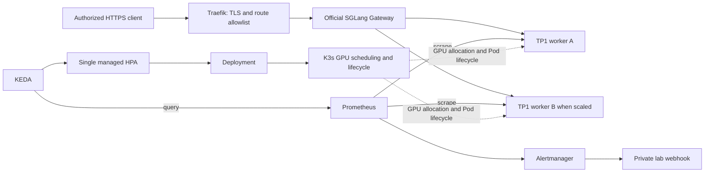

[English](architecture.md) | [简体中文](architecture.zh-CN.md)

# Implemented architecture and boundaries

The accepted cloud environment was **one full VM co-locating the K3s control plane
and two RTX A6000 GPUs**. It was destroyed after the sessions. The diagram describes
that implemented single-node architecture; split-node orchestration,DCGM and a
custom project Helm chart are future work,not installed capabilities.

| Layer | Implementation |
| --- | --- |
| Local baseline | Docker Compose,SGLang,Prometheus,provisioned Grafana;loopback only |
| CPU control lab | Separate three-node kind cluster,mock workers,official Gateway |
| Cloud orchestration | Single-node K3s v1.36.5+k3s1,NVIDIA runtime/device-plugin v0.20.1 |
| Engine/model | SGLang0.5.21,Qwen/Qwen3-0.6B,model revision and image digest pinned |
| Routing | Official Gateway0.3.2,Pod discovery,health gates,round_robin,retries disabled |
| Scaling | KEDA2.21.0,one HPA,min1/max2,AverageValue4,running+queued,120s down stabilization |
| Edge | Traefik3.7.16/Chart42.1.3,host80/443,HTTP-01,local ACME persistence |
| Alerting | Prometheus3.7.3,Alertmanager0.34.2,private bounded webhook receiver |
| Packaging | Versioned YAML/Kustomize plus upstream Helm charts and staged Python/Bash tooling |

## Three flows and their owners

### 1. Deployment: establish the environment, then exit

The operator runs launch.py locally against an explicitly selected new VM.
It prepares pinned tools and private inputs, bootstraps K3s/GPU support, deploys
the serving components, checks authentication, enables replica autoscaling and
publishes restricted HTTPS. Its temporary API tunnel closes when the command ends.
The launcher is not an online controller: it does not have to remain running for
inference or replica scaling. --resume continues the same owned deployment after
identity/source checks; it is not a general-purpose reconciler.

### 2. Requests: HTTPS entry to a healthy engine

Traefik terminates TLS and applies the inference-path allowlist and configured
ingress limits. The official Gateway checks the shared inference credential,
discovers workers and routes only to healthy backends. SGLang performs token
scheduling, prefill/decode and KV-cache management on the GPU allocated to its Pod.
The Gateway chooses a replica; it does not choose a free GPU for each request.
With the default TP1 profile, every worker Pod owns one whole GPU.

### 3. Elasticity and recovery: metrics to Pod lifecycle

Prometheus scrapes each worker's running/queued metrics. KEDA exposes the selected
metric through the external-metrics API and manages one HPA. The HPA computes
desired replicas under its target, bounds and stabilization rules and updates the
Deployment. K3s creates/removes Pods; the NVIDIA device plugin supplies whole-GPU
allocation. A new Pod needs model warm-up before it is healthy and routable.

During normal termination the engine becomes unready and drains admitted work
within its grace period. Gateway health discovery has convergence delay, so this
is not a zero-error transition guarantee. Alertmanager independently notifies the
private receiver when the no-Ready-worker rule fires or resolves. Alerts report
conditions; they do not perform rollback. The explicit operations tool performs
the planned failed-configuration rollout and restoration.

| Setting/component | Controls | Does not establish |
| --- | --- | --- |
| launch.py | Initial deployment and owned-stage continuation | Ongoing request or scaling decisions |
| Gateway | Healthy backend selection per request | GPU allocation or tensor parallelism |
| KEDA/HPA replica count | Number of serving instances in the existing pool | New cloud nodes/cards or faster individual tokens |
| SGLang TP | GPUs jointly computing one instance | Number of independent replicas |
| SGLang running/queued limits | Engine admission and active work bounds | A fixed static batch size or measured SLO |
| K3s + NVIDIA plugin | Pod placement and whole-GPU allocation | Engine token scheduling or node purchasing |

## GPU accounting

| Profile | Replicas | TP per replica | GPU per replica | Total GPUs |
| --- | ---: | ---: | ---: | ---: |
| local-mock |1–2|N/A|0|0|
| cloud-tp2 |1|2|2|2|
| cloud-replicas/autoscale |1–2|1|1|1–2|

Profiles run sequentially. Two TP2 replicas require four GPUs. A small model
demonstrates TP execution,not a speedup. GPU allocation is Kubernetes whole-device
placement; SGLang handles token scheduling,KV cache and tensor-parallel computation.
Node-local RWO cache is not distributed/HA storage.

## Contracts and tradeoffs

- Only Ready workers enter routing. Loading,liveness and readiness differ.
- KEDA's single HPA owns replicas. Missing metrics are errors with a static2-replica
  fallback after3 failures,not zero load. Telemetry failure/recovery was tested locally;
  the real cloud load loop did not inject telemetry outage.
- Replica scaling uses existing capacity; it does not purchase or join GPU nodes.
  Cold start can exceed client waiting budgets.
- Normal SIGTERM drain uses180s grace. maxSurge0/maxUnavailable1 accepts temporary
  capacity loss; the one-replica rollback experiment intentionally produced503.
- Gateway and worker share a Secret due to fixed0.3.2 credential coupling; frontend/
  backend keys are not independently isolated. Public HTTPS exposes only the three
  POST inference paths. Metrics,management and cluster API stay private.
- Cloud Grafana/DCGM,NetworkPolicy enforcement,node/control-plane HA,hard-crash/OOM,
  sustained SLOs,zero-error updates,tenant isolation and multi-node TP/PP are unverified
  or outside v1. Compose Grafana does not imply a cloud Grafana deployment.

See [evidence](presentation.md),[cloud rebuild](cloud-rebuild.md),[HTTPS](https.md),
[acceptance](acceptance.md) and [recovery](operations.md).
