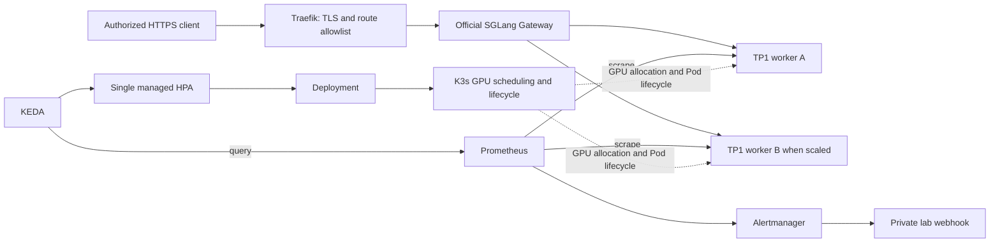

[English](architecture.md) | [简体中文](architecture.zh-CN.md)

# 已实现架构与边界

已验收的云环境是**一台完整VM，同时运行K3s控制面和两张RTX A6000**，实验后已销毁。
图示为实际单节点架构；拆分控制/工作节点、DCGM和自制项目Helm chart属于后续工作，不是已安装能力。

| 层次 | 实现 |
| --- | --- |
| 本地基线 | Docker Compose、SGLang、Prometheus、自动配置Grafana；仅loopback |
| CPU控制实验 | 独立三节点kind、mock worker、官方Gateway |
| 云编排 | 单节点K3s v1.36.5+k3s1、NVIDIA runtime/device-plugin v0.20.1 |
| 引擎/模型 | SGLang0.5.21、Qwen/Qwen3-0.6B，模型revision与镜像digest固定 |
| 路由 | 官方Gateway0.3.2，Pod发现、健康门控、round_robin、禁重试 |
| 伸缩 | KEDA2.21.0，唯一HPA，min1/max2、AverageValue4、running+queued、缩容稳定120秒 |
| 入口 | Traefik3.7.16/Chart42.1.3，host80/443、HTTP-01、本地ACME持久化 |
| 告警 | Prometheus3.7.3、Alertmanager0.34.2、私有有界webhook |
| 打包 | 版本化YAML/Kustomize、上游Helm chart、分阶段Python/Bash工具 |

## 三条流程与职责

### 1. 部署：建立环境后退出

操作者在本地运行launch.py，明确指定新VM。入口准备固定工具和私有输入，
初始化K3s/GPU，部署组件，检查鉴权，启用副本伸缩并发布受限HTTPS。
命令结束会关闭临时API隧道。Launcher不是在线控制器，推理和伸缩不依赖它持续运行。
--resume核对身份/源码后继续同一归属部署，不是通用协调器。

### 2. 请求：HTTPS入口到健康引擎

Traefik终止TLS，应用推理路径白名单和已配置入口限制。
官方Gateway校验共用推理凭据，发现worker，只向健康后端路由。
SGLang在Pod分配到的GPU上执行token调度、prefill/decode和KV cache管理。
Gateway选择的是副本，不是为每个请求寻找空闲GPU。默认TP1下每个worker Pod占一张完整卡。

### 3. 弹性与恢复：指标驱动Pod生命周期

Prometheus逐worker采集running/queued指标。KEDA通过external-metrics API提供选定指标，
并管理唯一HPA。HPA按目标、上下限和稳定窗口计算期望副本并更新Deployment。
K3s创建/移除Pod，NVIDIA device plugin提供整卡分配。新Pod必须加载预热，
健康后才能接流。

正常终止时引擎先不就绪，在grace内完成已准入任务。Gateway健康发现存在收敛延迟，
不保证过渡期间零错误。Alertmanager独立向私有接收器投递无Ready worker的触发/恢复通知；
告警只报告状态，不自动回滚。显式运维工具执行计划错误配置发布与恢复。

| 设置/组件 | 负责 | 不代表 |
| --- | --- | --- |
| launch.py | 初次部署及本轮阶段续跑 | 持续请求或伸缩决策 |
| Gateway | 为请求选择健康副本 | 分配GPU或张量并行 |
| KEDA/HPA副本数 | 现有GPU池内服务实例数量 | 自动增加云节点/卡或单token变快 |
| SGLang TP | 一个实例共同计算的GPU数量 | 独立副本数量 |
| SGLang running/queued限制 | 引擎准入及活动任务边界 | 固定静态batch size或测得SLO |
| K3s + NVIDIA plugin | Pod放置与整卡分配 | 引擎token调度或采购节点 |

## GPU账本

| Profile | 副本 | 每副本TP | 每副本GPU | 总GPU |
| --- | ---: | ---: | ---: | ---: |
| local-mock |1–2|N/A|0|0|
| cloud-tp2 |1|2|2|2|
| cloud-replicas/autoscale |1–2|1|1|1–2|

profile顺序运行，两个TP2副本需要四卡。小模型只能证明TP执行，不能证明加速。
Kubernetes负责整卡分配和放置，SGLang负责token调度、KV cache及张量并行。
节点本地RWO缓存不是分布式/HA存储。

## 约定与代价

- 只有Ready worker接流；加载、存活与就绪不同。
- 唯一KEDA HPA管理副本。缺指标是错误，连续3失败静态fallback2，不是零负载。
  指标故障/恢复只在本地测过；云负载闭环没有注入指标故障。
- 副本弹性使用现有卡，不采购或加入节点；冷启动可能超过客户端等待预算。
- 正常SIGTERM使用180秒grace；maxSurge0/maxUnavailable1接受容量下降。
  单副本回滚实验有计划地返回过503。
- 固定Gateway0.3.2耦合前后端凭据，因此与worker共用Secret，不宣称独立密钥隔离。
  公网HTTPS仅开放三个POST推理路径；指标、管理和集群API保持私有。
- 云Grafana/DCGM、NetworkPolicy执行、节点/控制面HA、硬崩溃/OOM、持续SLO、
  无错误更新、租户隔离、多节点TP/PP尚未验证或不属于v1。本地Grafana不代表云上已部署。

见[证据](presentation.zh-CN.md)、[重建](cloud-rebuild.zh-CN.md)、[HTTPS](https.zh-CN.md)、
[验收](acceptance.zh-CN.md)及[恢复](operations.zh-CN.md)。
